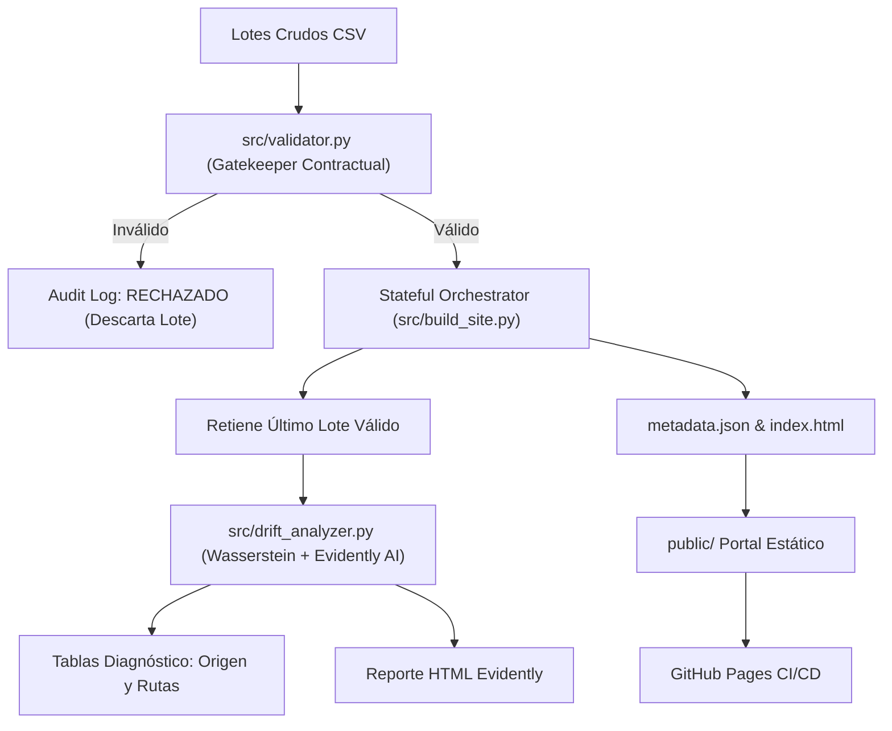
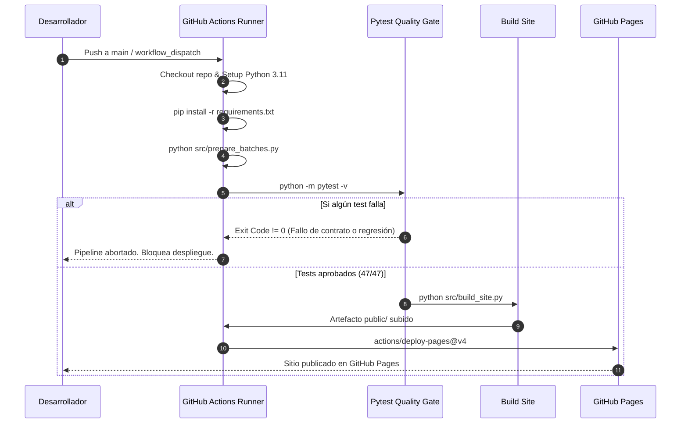

# Sistema Automatizado de Validación de Lotes y Monitoreo de Data Drift (NYC Flights 2013)

[](https://github.com/usuario/TrabajoNYC-aviones/actions/workflows/deploy_pages.yml)
[](https://www.python.org/)
[](https://www.evidentlyai.com/)
[](#arquitectura-del-sistema)

Sistema integral de ingeniería de datos y observabilidad operacional diseñado para validar por contrato lotes mensuales de vuelos del área metropolitana de Nueva York (JFK, LGA, EWR), detectar desviaciones estadísticas (*data drift*) y publicar automáticamente un portal de diagnóstico operacional en GitHub Pages mediante Integración y Despliegue Continuo (CI/CD).

---

## Caso de Uso y Contexto de Datos

El dataset maestro (`vuelos_nyc_2013.csv`) contiene 36.000 registros de vuelos operados en 2013 desde los aeropuertos de Nueva York, divididos en lotes homogéneos de 12.000 filas:

* **Lote Referencia (Enero 2013)**: Línea base de estabilidad operacional (`2013-01-01` a `2013-01-31`).
* **Lote Control (Febrero 2013)**: Lote candidato con variaciones operacionales normales respecto a enero (`2013-02-01` a `2013-02-28`).
* **Lote Nuevo (Julio 2013)**: Lote candidato con degradación operacional severa y marcado *drift* estacional en demoras debido al verano (`2013-07-01` a `2013-07-31`).
* **Lote Corrupto (Sintético)**: Lote de prueba de 11.500 filas con un aeropuerto de origen no autorizado (`MIA`) y etiqueta alterada, diseñado para probar la resiliencia y el rechazo en el *Quality Gate*.

---

## Arquitectura del Sistema

El pipeline opera bajo un paradigma funcional estructurado en 3 componentes desacoplados:



### 1. Gatekeeper de Validación Contractual (`src/validator.py`)
Evalúa 6 reglas sin dependencias pesadas:
1. **Esquema Exacto**: Requiere exactamente 8 columnas (`vuelo_id`, `fecha`, `origen`, `destino`, `demora_salida_min`, `demora_llegada_min`, `distancia_millas`, `lote`). Si falla, aborta inmediatamente.
2. **Volumen de Muestra Fijo**: Exactamente 12.000 filas (`len(df) == 12000`).
3. **Integridad y Unicidad**: 0 nulos en todas las columnas y 0 valores duplicados en `vuelo_id`.
4. **Dominio de Aeropuertos**: `origen` estrictamente en `{"JFK", "LGA", "EWR"}`; `destino` conforme al estándar IATA de 3 letras mayúsculas (`^[A-Z]{3}$`); y `origen != destino`.
5. **Rangos Físicos y Tipos**: Columnas numéricas con límites `distancia_millas` en $[10, 6000]$ y demoras en $[-120, 1500]$ minutos.
6. **Coherencia Temporal y Etiqueta**: Fechas válidas `YYYY-MM-DD` en el año 2013, un único mes calendario por lote, y etiqueta `lote` consistente.

### 2. Motor de Data Drift y Diagnósticos Operacionales (`src/drift_analyzer.py`)
* **Detección de Drift**: Calcula la distancia de Wasserstein normalizada con `scipy.stats` dividida por la desviación estándar del lote de referencia:
  $$\mathcal{D}_{\text{norm}} = \frac{\mathcal{W}(\text{ref}, \text{act})}{\sigma_{\text{ref}}}$$
  Dispara alerta operacional (`hay_drift = True`) si el drift en `demora_salida_min` o `demora_llegada_min` supera el umbral de `0.10`.
* **Reporte Evidently**: Genera un reporte exhaustivo exportado a `evidently_report.html` mediante `DataDriftPreset`, garantizando compatibilidad reflexiva con `inspect.signature` entre versiones de Evidently (0.4.x vs 0.6+ / 0.7+).
* **Diagnóstico por Origen**: Tabla agregada por `EWR`, `JFK`, `LGA` con volumen de vuelos, medias de demoras, porcentaje de vuelos con demora $\ge 15\text{ min}$ y sus deltas (`act - ref`).
* **Diagnóstico por Rutas Críticas**: Identifica pares `origen -> destino` con un filtro muestral estricto ($\ge 50$ vuelos en ambos meses) y las ordena descendentemente por degradación de demora de llegada.

### 3. Orquestador Stateful y Generador Web (`src/build_site.py`)
Procesa secuencialmente la lista de candidatos (`control`, `nuevo`, `corrupto`):
* Si un lote es rechazado, registra el error en `audit_log` y continúa sin corromper el estado retenido.
* Retiene en memoria el último lote válido procesado (`last_valid_df`).
* Coordina la generación de `metadata.json`, `evidently_report.html` y compila `index.html` con **Bootstrap 5** mostrando el historial de auditoría, las métricas de drift y las tablas de diagnóstico.

---

## Estructura del Proyecto

```text
TrabajoNYC-aviones/
├── .github/
│   └── workflows/
│       └── deploy_pages.yml       # Workflow CI/CD de validación y despliegue a GitHub Pages
├── data/
│   ├── raw/
│   │   └── vuelos_nyc_2013.csv    # Dataset maestro con 36.000 registros
│   └── batches/                   # Lotes procesados (ignorado en Git)
│       ├── lote_referencia.csv
│       ├── lote_control.csv
│       ├── lote_nuevo.csv
│       └── lote_corrupto.csv
├── public/                        # Portal estático generado (ignorado en Git)
│   ├── index.html                 # Dashboard operacional con Bootstrap 5
│   ├── evidently_report.html      # Reporte interactivo de Evidently AI
│   └── metadata.json              # Metadatos del pipeline y métricas Wasserstein
├── src/
│   ├── __init__.py
│   ├── prepare_batches.py         # Particionamiento e ingesta de lotes
│   ├── validator.py               # Motor de validación contractual (Gatekeeper)
│   ├── drift_analyzer.py          # Analizador de data drift y diagnósticos estadísticos
│   └── build_site.py              # Orquestador del pipeline y generador del sitio
├── tests/
│   ├── __init__.py
│   ├── test_validator.py          # 38 pruebas unitarias e integración de contratos
│   ├── test_drift_analyzer.py     # 6 pruebas de drift, rutas críticas y Evidently
│   └── test_build_site.py         # 3 pruebas de orquestación, resiliencia y exportación
├── .gitignore                     # Configuración de exclusión para datos y entornos
├── pytest.ini                     # Configuración de pythonpath y testpaths
├── README.md                      # Documentación técnica del sistema
└── requirements.txt               # Dependencias base versionadas
```

---

## Guía de Ejecución Local

### 1. Clonar el repositorio y configurar el entorno
```bash
git clone https://github.com/usuario/TrabajoNYC-aviones.git
cd TrabajoNYC-aviones

# Crear y activar entorno virtual
python -m venv .venv
# En Linux/macOS:
source .venv/bin/activate
# En Windows (PowerShell):
.venv\Scripts\Activate.ps1
```

### 2. Instalar dependencias
```bash
pip install --upgrade pip
pip install -r requirements.txt
```

### 3. Particionar los lotes de datos
Genera los 4 archivos CSV en `data/batches/`:
```bash
python src/prepare_batches.py
```

### 4. Ejecutar la suite de pruebas automatizadas
Ejecuta los 47 tests unitarios y de integración:
```bash
python -m pytest -v
```

### 5. Compilar el sitio estático y dashboard
Ejecuta el orquestador para procesar los lotes y generar la carpeta `public/`:
```bash
python src/build_site.py
```

### 6. Visualizar localmente el Dashboard
Levanta un servidor HTTP local para interactuar con el portal:
```bash
python -m http.server 8000 -d public
```
Abre tu navegador en [http://localhost:8000](http://localhost:8000).

---

## Pipeline de CI/CD (GitHub Actions)

El workflow [`.github/workflows/deploy_pages.yml`](.github/workflows/deploy_pages.yml) automatiza el ciclo de vida de entrega continua:



### Protección de Calidad (*Quality Gate*)
* **Generación bajo demanda**: Como `data/batches/` y `public/` están ignorados en el control de versiones, el runner crea los lotes temporalmente a partir de `data/raw/vuelos_nyc_2013.csv`.
* **Garantía contractual inquebrantable**: Si un lote contiene esquemas alterados, nulos, IDs duplicados o aeropuertos no autorizados, los tests fallan y la ejecución se aborta inmediatamente.
* **Despliegue seguro a producción**: GitHub Pages solo se actualiza si el 100% de los tests pasan exitosamente, garantizando que el portal público refleje siempre el último estado operacional verificado.
